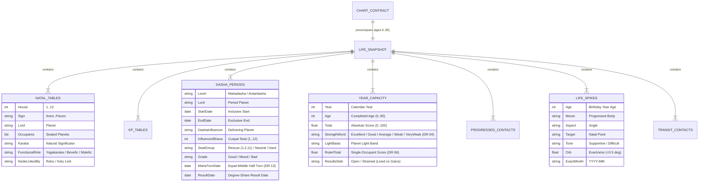

# Deterministic Temporal Engine (`LPRC`) & Shared Rule Cores (`DR-01` – `DR-68`)

In Kotti Astro, **no LLM ever calculates a planetary position, a period date, a house weight, or a timing rank.** All astronomical, dasha, progression, and house-flow mathematics are executed by the deterministic **LPRC** engine and stored as an immutable **Life Snapshot** (`0–85` years) in PostgreSQL.

Both conversational engines (**Advisor Hybrid** and **Advisor Library**) read from this shared snapshot and invoke shared, stateless rule cores.

---

## 1. The Precomputed Life Snapshot Contract

When a birth profile is analyzed, the background preparation workers compute and persist a comprehensive snapshot spanning every birthday year from birth through age 85 (`LivingLimit`, the day before the 86th birthday):

---

## 2. Core Domain Rules (`DR-01` – `DR-68`)

Through iterative validation with domain experts and consultation transcripts, 68 astrological rules were formalized into deterministic code (`Source/Design/DashaRules.md`). Below are the foundational mechanics shared across the platform:

### 2.1 Absolute Score Strength Words (`DR-04`)
Every planet and house in every birthday year is assigned a canonical `StrengthWord` from its absolute `Total` score out of 100 (replacing relative 1–9 rank labels):
- **`Excellent`**: `>= 85.0`
- **`Good`**: `70.0 – 84.9`
- **`Average`**: `55.0 – 69.9`
- **`Weak`**: `35.0 – 54.9`
- **`VeryWeak`**: `< 35.0`

### 2.2 Three-Voice House Weighting & Delivery Chains
Each house's results in a given year are governed by three voices (`KottiPlanetCapacity`):
- **Occupied House:** Leading Occupant **`60%`** + House Lord **`20%`** + Natural Karaka **`20%`**.
- **Empty House:** House Lord **`80%`** (`LordAsOccupant`) + Natural Karaka **`20%`**.
- **Rented vs. Free Houses:** When a planet rules two houses and another planet occupies one of them, the occupied house is *rented* (the lord retains only its `20%` share there) and the lord carries its *free* (empty) house (`80%`) into the house where it sits as its main theme.
- **Dasha Influencer & Final Result Giver:** Every planet delivers its results through its stored `DashaInfluencer` (determined by star lordship or the 4 Dasha Rules). If the result giver sits in a house led by another planet, that house leader controls the temperament of the delivery—*except* when the result giver sits in a **Rescue House (`1st`, `2nd`, or `11th` bhava)**, which protects the period and delivers good results regardless of the planet's own weakness.

### 2.3 Two-House Lord Halves (`DR-12`, `DR-13`, `DR-14`, `B18`)
- **When Halves Run:** A planet ruling two signs runs in two equal halves (`MahaTurnDate` at the exact clock midpoint of the period, `DR-13`) when **both houses are empty** or **both houses are occupied** (even if the lord itself sits in one of its own houses, `B18`). If another planet occupies *only one* of the two houses, the lord gives the empty house for the entire period without halving.
- **Order of Halves:** By default, the Moolatrikona house (or earlier sign from Lagna for Mercury) gives results in the first half, and the other house in the second half; a retrograde planet reverses this order.
- **Neutral Hard Half (`DR-14`):** When one of a planet's two houses is a Dusthana (`6th`, `8th`, or `12th`) and the other is a Trikona (`1st`, `5th`, or `9th`), the Dusthana half is neutralized and switches on neither house during its half.

### 2.4 Retrograde & Node-Tied Split Evaluation (`DR-28` – `DR-34`, `DR-52` – `DR-53`)
A planet does not automatically split its house results merely for being retrograde or linked to Rahu/Ketu. Under `DR-28` and `DR-33`, a split between the **Lived Side** (people/health/self) and the **Worldly Gains Side** (money/status) is triggered *only* when all four conditions hold in the evaluated year:
1. The planet's stored `LightBasis` is in a faulted band,
2. Its strength word is weak (`Weak` or `VeryWeak`),
3. Its `DashaInfluencer` sits outside the rescue houses (`1st`, `2nd`, `11th`), and
4. Its own Mahadasha or Antardasha is currently running.
- **Cancellation (`DR-33`, `DR-52`):** If a planet is *both* retrograde and node-linked (or its star lord is also retrograde, `-1 * -1 = +1`), its stored light moves into the `Cancellation` band and no split is told.

---

## 3. Shared Pure-Function Rule Cores

To guarantee that **Advisor Hybrid**, **Advisor Library**, and **Dasha Summary** never diverge on complex multi-factor selections, key rules are encapsulated as zero-dependency pure-function modules:

```mermaid
flowchart LR
  subgraph Inputs["Caller-Supplied Period Slice"]
    I1["Running Lords (Main, Sub) & Yearly Givers"]
    I2["YearCapacity House Rows (Occupant, Lord, Karaka)"]
    I3["Switched-On Houses (DR-18 Half-Aware)"]
    I4["Road Gate & Life-Stage Filter Functions"]
  end

  subgraph ActiveCore["KottiActiveHouses.py (DR-68)"]
    A1["Running(): Unique [Main, Giver(Main), Sub, Giver(Sub)]"]
    A2["PartsOf(): Sum 60 / 20 / 20 Shares per Switched House"]
    A3["Told(): Select Houses >= 80 Parts (Pull >= 60 if < 3 Houses)"]
    A4["RowsInside(): Match KottiGrokEvents Together Sets (Len > 1)"]
    A5["Rank by MeanParts(), Set Size & Table Order"]
  end

  Inputs --> A1 --> A2 --> A3 --> A4 --> A5
```

### 3.1 Most Active Houses of a Sub-Period (`KottiActiveHouses.py`, `DR-68`)
Rather than listing every house switched on during a sub-period, `KottiActiveHouses.Read()` identifies the **most active houses** and the specific life combinations they form:
1. Collects the up-to-4 active planets of the sub-period in that birthday year: `[MainLord, Giver(MainLord), SubLord, Giver(SubLord)]`.
2. For each switched-on house, sums the `60 / 20 / 20` shares held by those running planets (`PartsOf`). A planet holding both Occupant (`60`) and Lord (`20`) contributes `80` parts; all three roles contribute `100` parts.
3. Selects all houses with **`>= 80` parts** (`Top`). If fewer than `3` houses (`Least = 3`) reach `80`, it pulls in houses with **`>= 60` parts** (`Pull`).
4. Runs `KottiGrokEvents.RowTest()` over the selected houses to find all multi-house event combinations (`len(Set) > 1`) whose required houses are 100% present, ranking them by highest mean parts (`MeanParts`), largest set size, and canonical event-table order, filtered by the caller's gate (`MoonAfflictionRows`, `DebilitationRows`, `BothLordsRows`) and life-stage appropriateness (`Own`).

### 3.2 High-Spike Progressions by Sub-Period Grade (`KottiHighSpikes.py`, `DR-67`)
When summarizing a multi-year Mahadasha (such as a 20-year Venus period), narrating all 20 birthday years creates noise. `KottiHighSpikes.Read()` filters `LifeSpikes` (progressed contacts within `0.5°` orb) using the frozen progression judge's signed point weights (`AnnualPoints`):
- Selects any spike with **`abs(Points) >= 50`**, plus any **difficult** spike that lands inside a sub-period graded `Mixed` or `Bad`.
- Classifies each spike into one of four teacher interpretations (`KindOf`) based on `(Contact is Difficult, Sub-Period is Mixed/Bad)`:

| Progression Contact Tone | Sub-Period Grade: `Good` | Sub-Period Grade: `Mixed` or `Bad` |
| :--- | :--- | :--- |
| **Supportive (`+ve >= 50 pts`)** | **`Peak`** — Full breakthrough / high point | **`Lift`** — Relief / modest lift, not a full peak |
| **Difficult (`-ve`)** | **`Pinch`** — Temporary pinch (`>= 50 pts`) that passes | **`HardTime`** — Full strain (told at any point size) |
