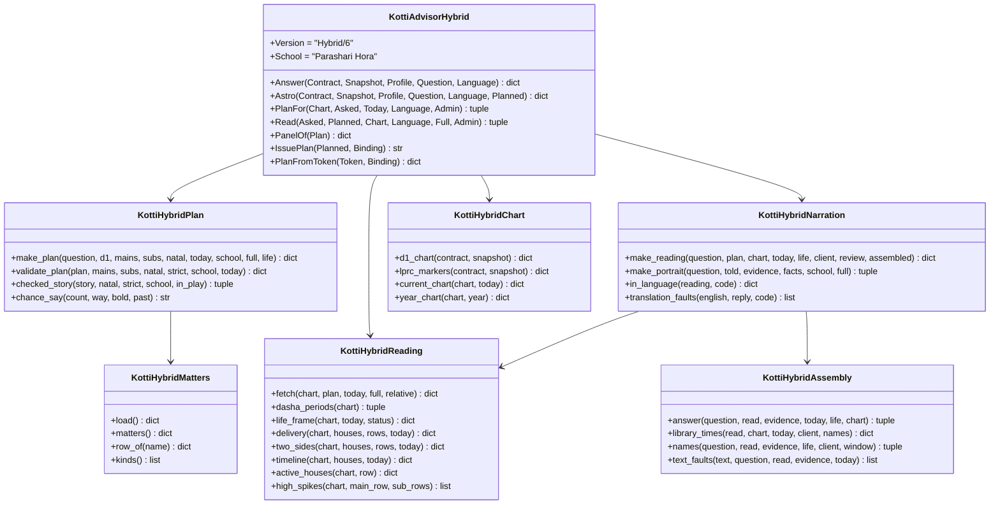
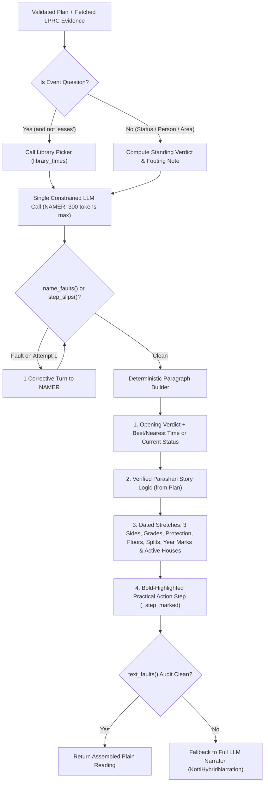

# Advisor Hybrid (`Hybrid/6`) — Neuro-Symbolic Architecture Deep-Dive

**Advisor Hybrid** is the flagship conversational reasoning mode of the Kotti Astro platform (`POST /Api/Advisor/Ask` with `Mode: "Hybrid"`). It was architected to solve a fundamental failure mode of generative AI in analytical domains: **when an LLM is asked to simultaneously select domain rules, weigh conflicting time-series rows, and write empathetic prose, it drifts on factual numbers and dates.**

---

## 1. Architectural Evolution & Empirical Design

Advisor Hybrid evolved through six major iterations (`Hybrid/1` through `Hybrid/6`), driven by continuous evaluation against 50 canonical client questions and 133 confirmed historical consultation facts:

1. **Dual-School Separation of Concerns:**
   - **Selection (`KP Stellar Astrology`):** Krishnamurti Paddhati (KP) excels at mapping specific life events to crisp house combinations (`need` sets and `also` supporting houses).
   - **Causal Explanation (`Parashari Hora`):** Classical Parashari (`Brihat Parashara Hora Shastra`) excels at explaining *why* a life area behaves the way it does through lordships, placements, functional roles, and yogas.
   - **Rule:** The first LLM probe selects houses and dashas using KP and writes a 2–3 sentence causal `story_logic` grounded in Parashari Hora.
2. **Code-Assembled Plain Prose vs. Free-Form LLM Narration:**
   - In blind evaluations of 36 side-by-side readings, replacing free-form LLM narration with **Code-Assembled Plain Prose** (`KottiHybridAssembly`) + a constrained micro-LLM call (`NAMER`) won **26 to 6 (with 4 ties)**.
   - Where deterministic code writes the opening verdict, the exact dates, the chance labels, and the 3-layer support breakdown, factual drift drops to zero.

---

## 2. Module Architecture

The Hybrid subsystem consists of 7 core Python modules, 2 shared pure-function rule cores, and a dedicated React explainability UI:

---

## 3. Deep-Dive: The 5 Execution Stages

### Stage 1: In-Memory Taxonomic Planning (`KottiHybridPlan` & `KottiHybridMatters`)
- **Zero-Disk Taxonomy Lookup:** `KottiHybridMatters` loads `KottiGrokEventsLean.json` (100 curated event matters with `matter`, `kind` [`Gain`, `Risk`, `State`], `need` house sets, and `also` helping houses) into memory at startup and verifies its SHA-256 fingerprint against the master event table (`KottiGrokEvents.py`), automatically rebuilding the lean JSON via subprocess if the source table changed.
- **Six Canonical Time Windows:** Rather than using brittle regexes in Python to guess what time period a user is asking about, the first LLM probe classifies the query into one of six windows (`today`, `period`, `named`, `ahead`, `life`, `behind`), and deterministic code computes the exact ISO date boundaries:
  - `today`: The single date asked (for non-event status questions like *"How is my life?"*).
  - `period`: The exact start and end dates of a named Mahadasha or Antardasha (e.g., *"How is my Ketu period?"* or *"How is my current main period?"*) looked up from stored tables.
  - `ahead`: A 5-year forward window (`AHEAD_YEARS = 5`).
  - `life`: From today through the living limit (age 85, the day before the 86th birthday).
  - `behind`: From birth up to today.
  - `named`: Explicit calendar years or age spans named in the question.
- **Two-Attempt Strict Validation (`validate_plan`):**
  - Strips markdown fences and stray non-ASCII tokens outside JSON strings (`_STRAY`).
  - Matches the LLM's chosen matter(s) (up to `MATTER_LIMIT = 2`) against `KP_LIST` and enforces the canonical house sets from the table.
  - Clips selected dashas to the client's relevant `life_stages` so a career or promotion question at age 49 does not search retirement stages at age 72.
  - Runs `checked_story()` to verify every planet placement, house lordship, dignity, retrograde flag, node link, and functional role cited in `story_logic` against the stored natal snapshot, dropping any unverified clause.

### Stage 2: Deterministic LPRC Evidence Fetch (`KottiHybridReading`)
Once the plan is validated, `KottiHybridReading.fetch()` extracts a compact, tabular evidence packet from the precomputed life snapshot:
- **`periods` block:** Every sub-period stretch clipped to birthday years, annotated with:
  - `houses_on`, `all_on`, `sets_on`, `also_on`, `missing`, and `missing_count`.
  - The 3 stored gradings (`progression` verdict, `main` period grade, `sub` period grade) and their tallies (`in_favour` and `against` on a `0..3` scale where `Mixed`/`Balanced` counts `0.5`).
  - Level metadata (`LEVEL_COLUMNS`): `lord`, `influencer`, `influencer_house` (cuspal bhava), `protected` (`RescueHouses` 1, 2, 11), `grade`, `star_lord_plus` (`DR-08`), `graded_by` (`Leader` `DR-57` or `Rule4` `DR-56`), `lasting_strength` (`DR-35`–`DR-36` Pancha Mahapurusha floor), `care` (`DR-38` Balarishta + teacher meanings), `split` (`DR-28`–`DR-34` retrograde/node split), and `fault_from` (`DR-34`).
- **`delivery` block:** Exact 3-voice house breakdown (`Occupant 60%`, `Lord 20%`, `Karaka 20%`; or `Lord 80%`, `Karaka 20%` when empty), showing which houses are free vs. rented and how each voice's Dasha Influencer delivers results.
- **`two_sides` block:** Separates the *lived/personal side* of a house or period from its *worldly/material gains side* when a retrograde or node-afflicted split is active.
- **`timeline` block:** Attached for non-event descriptive questions, grouping birthday years from birth to age 85 into contiguous strength phases (`house_strength`, `lord_strength`, `status_said`).

### Stage 3: Code-Assembled Plain Answering (`KottiHybridAssembly`)
For the default `Plain` telling, `KottiHybridAssembly.answer()` avoids free-form LLM prose generation:

- **Canonical Chance Vocabulary (`CHANCES` / `FEARED_CHANCES`):**
  - Wanted events (`in_favour` 0 → 3): **`not likely`**, **`slim, with challenges`**, **`promise with challenges`**, **`good chance`**.
  - Feared events (`against` 0 → 3): **`not likely`**, **`a slim chance`**, **`possible, so take care`**, **`a strong chance, so take care`**.
- **Two-Matter Support (Decision B6):** When a question asks about two distinct matters (e.g., *"Will I get a job or start a business?"*), `second_matter()` times both matters independently through the Library picker and assembles a dedicated section for each.

### Stage 4: Full Narrator, Portrait Split & Second-Read Audit (`KottiHybridNarration`)
When the user clicks **Astro** (`Full=True`), or when an open-ended question requires full narrative synthesis:
- **Two-Trip Portrait + Timeline Split (`TWO_TRIPS`):** For questions describing a person (e.g., *"Tell me about my mother"*) or a core life area, `make_portrait()` runs first *without any dasha or period rows* so the model devotes 50% of the reading to a rich character/promise portrait without drifting into timelines. The portrait is then passed into the second trip to narrate the timeline phases (`timeline`).
- **Multi-Turn Deterministic Verification (`found()`):** Every generated reading is checked by deterministic Python validators for:
  - Leaked planet names in `Plain` mode (`names`),
  - Invented years outside the fetched records (`stray_years`),
  - Mismatched lordships, seats, leaders, or Dasha Influencers in `Astro` mode (`reading_faults`, `delivery_faults`),
  - Wrong chance labels for the row's tally (`chance_faults`, `library_chance_faults`),
  - Missing split, floor, care, or year-mark disclosures (`marks_faults`, `split_faults`, `year_marks_faults`),
  - Forbidden remedies, medical diagnoses, or fatalistic claims (`client_faults`).
- **Best-Attempt Retention (`best`) & Second Read (`review_faults`):** Across corrective turns, code tracks the attempt with the lowest `(grave_faults, total_faults)` tuple so a corrective turn that introduces a new error never overwrites a cleaner prior draft. Finally, a second-read LLM pass checks that the opening directly answers the user's question and contains no internal contradictions.

---

## 4. Explainable AI (XAI) Frontend (`AdvisorHybridData.jsx`)

Every Hybrid response includes a structured `Hybrid` metadata block rendered below the answer card:

1. **Chart Data Request Panel (`PanelOf`):**
   - **Date Range:** Exact ISO start and end dates evaluated.
   - **Houses Selected:** Shows whether houses came from the curated `KP House List` (with `Houses Together` need sets and `Supporting` houses) or `LLM, KP Stellar Astrology (Krishnamurti Paddhati)`.
   - **Requested Records:** `Natal`, `Periods`, `Months`, `Years`.
   - **Why These Records:** The planner's 1-sentence `focus` rationale.
2. **Interactive 3-Layer South Indian Year Chart (`KottiHybridChart`):**
   - Renders **Life Chart (`D`)**, **Progression (`P`)**, and **Slow Transit (`T`)** placements in a 12-sign South Indian grid.
   - Planets whose cuspal `bhava` differs from their sign house are rendered across a dashed cusp divider with their Roman house numeral (`CuspParts`).
   - Houses activated during the displayed birthday year are highlighted with an inset gold glow (`HouseGlow`).
   - Includes a **`− Year +` Scroll** (`GET /Api/Advisor/Hybrid/Chart`) allowing users to step year-by-year from birth to age 85, dynamically updating the `<Mahadasha> - <Antardasha>` header and active house glow with zero LLM latency.
