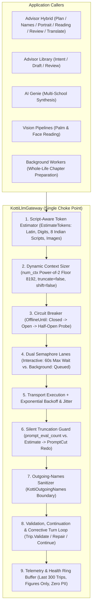

# Single LLM Gateway, Fault Tolerance & Multi-Tier Guardrails

A core architectural rule of the Kotti Astro platform is that **every language model invocation must pass through a single gateway (`KottiLlmGateway`)**, and **no model output is trusted without deterministic post-condition verification.**

---

## 1. The Single-Chokepoint LLM Gateway (`KottiLlmGateway.py`)

Centralizing all model traffic (`Run`, `RunMany`, `ExtractThenAnswer`) behind a single module eliminates scattered retry logic, inconsistent token budgets, and unmonitored failure modes.

### Key Engineering Mechanisms in `KottiLlmGateway`

1. **Script-Aware Token Estimation & `PromptCut` Detection:**
   - Standard character-div-4 estimators fail badly on Indian scripts (Telugu, Hindi, Tamil, Kannada, Malayalam, Marathi, Gujarati, Bengali), where UTF-8 code points tokenize at higher rates than Latin text.
   - `EstimateTokens()` uses calibrated per-script token rates plus `1024` tokens per attached image (`KA_LLM_IMAGE_TOKENS`) to compute a power-of-two `num_ctx` window with `'truncate': False` and `'shift': False`.
   - **Post-Call Verification:** After every reply, the gateway inspects `prompt_eval_count` returned by the model host. If the host evaluated fewer than 50% of the estimated prompt tokens (which happens when cloud/local servers silently truncate context), the gateway discards the poisoned reply, flags `PromptCut`, raises `num_ctx`, and re-executes the call.
2. **Thinking-Budget Exhaustion Recovery:**
   - Reasoning models can occasionally spend their entire `num_predict` token budget inside `<think>` blocks and return an empty visible reply.
   - Instead of doubling `num_predict` repeatedly (which previously caused 500-second tail latencies), the gateway detects an empty thinking reply and immediately re-issues one extra call at the same budget with `think='low'`.
3. **Two-Lane Concurrency Isolation (`Interactive` vs. `Background`):**
   - Live user chat requests (`Advisor/Hybrid`, `Advisor/Library`, `Advisor/Genie`) acquire the `Interactive` semaphore with a bounded wait (`KA_LLM_BUSY_WAIT_SECONDS`), failing fast with `Busy` rather than piling up behind batch jobs.
   - Long-running whole-life report generation runs on the `Background` lane.
   - Wait times during exponential backoff happen *outside* the semaphore so sleeping retries never block active workers.
4. **Circuit Breaker with Half-Open Probing:**
   - Consecutive connection failures, HTTP `429`, or `5xx` errors trip `OfflineUntil`.
   - Read timeouts on long generation trips do *not* trip the global breaker.
   - Once half the cooldown window elapses, `Admit()` allows exactly one half-open probe through; if it succeeds, the breaker closes immediately.

---

## 2. Defense-in-Depth Safety & Regulatory Guardrails

The platform enforces safety and regulatory compliance at four distinct layers:

```mermaid
flowchart LR
  subgraph L1["Layer 1: Pre-Inference Regulatory Gate"]
    G1["3-Script Lexical Matcher (BlockedPredictionTopics.json: EN, HI, TE)"]
    G2["Bounded 16-Token Classifier (Temp=0, Think=Off, 256-Entry NFC Cache)"]
  end

  subgraph L2["Layer 2: Demographic & Temporal Policy"]
    M1["Profile Age & Ownership Check (ChartOfAnotherProfile -> 409)"]
    M2["Minors Rule (Under 18: Refuse Adult Topics / Shift Love Queries to 18th Birthday)"]
  end

  subgraph L3["Layer 3: Deterministic Fact & Lexical Guards"]
    F1["Natal & Period Fact Checkers (checked_story, reading_faults, delivery_faults)"]
    F2["Forbidden Jargon & Remedy Filters (client_faults, plain_word_faults)"]
    F3["Status-Word Integrity Gate (KottiStatusWord + AST/DB AllowList)"]
  end

  subgraph L4["Layer 4: Post-Generation Translation Audit"]
    T1["4-Digit Year Exact-Set Equality (_years across Unicode scripts)"]
    T2["Target-Script Ratio (>50% Non-ASCII for Indic Scripts)"]
    T3["Markdown Heading Parity (_headings)"]
  end

  L1 --> L2 --> L3 --> L4
```

### Layer 1: Regulatory Restricted-Topic Gate (`KottiAdvisorRestricted.py`)
Runs before any chart lookup or planning call on non-admin requests:
- **Zero-Latency Lexical Reader (`LexicalHit`):** Scans the normalized query against curated regulatory patterns (`BlockedPredictionTopics.json`) across English, Hindi, and Telugu scripts (plus romanized transliterations) covering:
  - Pre-natal sex determination (PCPNDT compliance),
  - Gambling, lotteries, and speculative intraday/crypto tips,
  - Exact date/manner of death and self-harm,
  - Black magic, vashikaran, dowry, child marriage, and election exit-poll predictions.
  - Excludes benign homographs (`LexicalExcluded`, e.g., zodiac sign *Cancer* vs. medical diagnosis, or general wellbeing questions).
- **16-Token Model Classifier (`Classify`):** If the lexical reader passes, a fast `Extract`-role classification call (`Think=False`, `temperature=0`, max 16 tokens, ~1.1s) returns `RESTRICTED: YES` or `RESTRICTED: NO`, cached by NFC case-folded query string.

### Layer 2: Minors & Profile Isolation Policy (`KottiBirthDetails.py`, `KottiAdvisorHybrid.py`)
- **Cross-Profile Isolation (`ChartOfAnotherProfile`):** Prevents a request from pairing one family member's `ChartId` with another profile's `Sex` or `RelationshipStatus` (`409 ChartNotOfProfile`).
- **Minors Temporal Rewriting (`MinorRule` / `FromEighteen`):** When a query concerns marriage or romance for a profile under age 18, the platform does not halluncinate early dates or crash; `FromEighteen()` deterministically shifts the plan's evaluation window to start on the native's 18th birthday (`AdultAge = 18`) and re-validates the plan against the stored rows.

### Layer 3: Deterministic Fact-Graph & Client-Rule Verification
Every Hybrid reading is audited by deterministic Python functions before it can reach the user:
- **`checked_story()`:** Parses every statement in the planner's `story_logic` (`protected`, `period_grade`, `node_link`, `role`, `timeline`) and verifies it against the stored chart tables. If the LLM claims a planet is retrograde, combust, or in a rescue house when the stored table says otherwise, code strips or repairs the claim before narration begins.
- **`client_faults()` & `plain_word_faults()`:** Blocks medical diagnoses, named diseases, doctors/medicines, fatalistic predictions, and superstitious remedies (gemstones, mantras, rituals, fasting) and strips internal engine vocabulary (`Dasha Influencer`, `Kavach`, `light`, `performance`, `resource`, `capacity`, `lived side`, `gains side`) from client-facing prose.

### Layer 4: 9-Language Translation Verification (`translation_faults`)
Rather than prompting the LLM to reason directly in 9 languages (which degrades reasoning accuracy on smaller-resource languages), the platform **plans, assembles, and verifies every reading in canonical English first**, then runs a dedicated `TRANSLATOR` pass into the requested language (`hi`, `te`, `ta`, `kn`, `ml`, `mr`, `gu`, `bn`) and checks:
1. **Numeric & Year Invariance (`_years`):** Extracts all 4-digit year sequences across any Unicode decimal script (`unicodedata.decimal`) and requires exact set equality with the verified English reading.
2. **Script Purity:** Ensures translations into non-Latin scripts contain >50% native script characters.
3. **Structural Parity (`_headings`):** Ensures no markdown heading lines were dropped or invented.
4. **Graceful Disclosure (`translation_note`):** If a translation fails verification after a corrective retry, the verified English reading is served alongside a transparent note explaining why.
