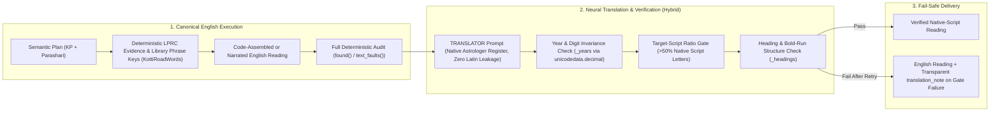
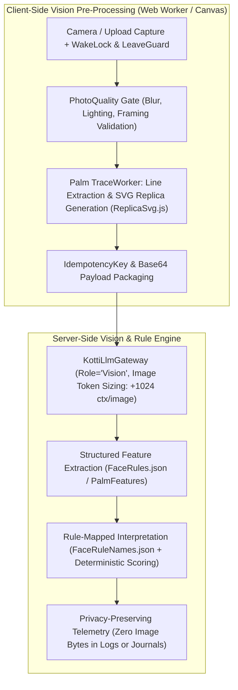

# Multimodal Vision, 9-Language Localization & Explainable UI Architecture

Beyond temporal reasoning and conversational Q&A, **Kotti Astro** integrates **computer vision pipelines** (Palm & Face analysis), a **9-language deterministic + neural localization architecture**, and an **Explainable AI (XAI) React SPA/PWA**.

---

## 1. 9-Language Localization Architecture (`en`, `hi`, `te`, `ta`, `kn`, `ml`, `mr`, `gu`, `bn`)

Supporting 8 Indian languages alongside English in a domain with dense technical terminology requires more than a generic translation wrapper:

### Dual-Strategy Localization
1. **Phrase-Bank Assembly (`KottiRoadWords.py`):**
   - In **Advisor Library**, every fixed sentence template, house meaning, period grade, and timing verdict is stored in a 9-language phrase matrix (`KottiRoadWords`), ensuring 100% deterministic terminology across all 9 languages for standard timing queries.
2. **Verify-in-English, Translate-Last (`KottiHybridNarration.in_language`):**
   - In **Advisor Hybrid**, all structural, numerical, and domain checks (`text_faults`, `chance_faults`, `marks_faults`, `split_faults`) run on the canonical English output first.
   - Once the English reading is verified, `translated()` converts it into the target language while enforcing:
     - **Cross-Script Year Parity:** Extracts 4-digit years across any Unicode decimal system (e.g., Devanagari, Telugu, Tamil, or ASCII digits) and rejects any translation that drops, alters, or invents a year.
     - **Script Purity:** Rejects transliterated Hinglish/Tanglish when a native script (`hi`, `te`, `ta`, `kn`, `ml`, `mr`, `gu`, `bn`) is requested.
     - **Formatting Preservation:** Preserves `**bold**` chance/action highlights and `##` or `**Heading**` lines.

---

## 2. Multimodal Vision Pipelines (Palm & Face Reading)

The platform includes dedicated vision pipelines (`KottiFaceReading.py`, `PalmReadingPage.jsx`, `TraceWorker.js`) that combine client-side image quality/geometry processing with single-gateway Vision LLM calls:

- **Strict Vision Gateway Isolation:** In `KottiLlmGateway`, any call carrying `images` or `Role='Vision'` automatically disables multi-turn continuation, caps retries at 2, allocates `1024` context tokens per image (`KA_LLM_IMAGE_TOKENS`), and forces `KeepTranscript = False` so base64 image payloads never leak into diagnostic logs or audit journals.

---

## 3. Explainable AI (XAI) & Frontend Engineering

The web client (`Source/Web`) is built with React and Vite under strict performance and explainability rules:

1. **Explainable AI (`AdvisorHybridData.jsx`):**
   - Every Hybrid answer exposes *why* the system reached its conclusion via the **Chart Data Request** panel (`Date Range`, `Houses Selected`, `Requested Records`, `Why These Records`) and the **3-Layer South Indian Chart** (`Life Chart`, `Progression`, `Slow Transit`).
   - Users can verify cuspal (`bhava`) shifts visually via dashed cell dividers (`CuspParts`) and scrub across 85 birthday years using the **`− Year +`** control (`ScrollOf` / `ScrollLanded`) with client-side caching (`Scroll.Held`).
2. **Dual-Persona Rendering (`HybridAstroOption`):**
   - Consumers read jargon-free prose (`Plain`) by default, while advanced users or astrologers click **`Astro`** to view the full technical breakdown (`<lord> gives its results through <influencer>`) backed by the same cryptographically signed plan (`Hybrid.Token`). Both views are cached on the client entry (`Hybrid.Texts`) for zero-latency toggling.
3. **Zero-Chunk-Bloat Route Splitting (`TestRouteSplit.js`):**
   - Component styles for specialized views (`AdvisorHybridData.jsx`) use CSS custom property tokens (`var(--Gold)`, `var(--Surface)`, `var(--AdvisorTealInk)`) so lazy-loaded route chunks never pull duplicate CSS bundles.

---

## 4. Automated Architecture & Quality Gates

The platform's reliability is enforced by automated test suites (`Source/Tests/` and `Source/Web/Tests/`) that fail the build on architectural or domain drift:

| Gate / Test Suite | What It Enforces |
| :--- | :--- |
| **`TestHybridCodex` & `TestHybridAssembly`** | Pins the 4-stage Hybrid pipeline, KP house matching, `NAMER` action-step highlighting, and deterministic fallback to the narrator. |
| **`TestHybridRuleGaps` & `TestHybridFinish`** | Verifies `DR-01` through `DR-68` compliance across Hybrid and Library (retrograde splits, cancellation bands, star-lord plus, equal halves). |
| **`TestActiveHouses` & `TestHighSpikes`** | Pins the shared `DR-68` (`>=80` / `>=60` house parts) and `DR-67` (`>=50` progression spike points) pure-function cores across all callers. |
| **`TestStatusWord` & `CheckStatusWord.py`** | AST and database allow-list scanner ensuring internal status/standing vocabulary conforms to owner-approved terminology across code and prompts. |
| **`TestAdvisorGuard` & `TestHybridYesFeared`** | Verifies regulatory refusals, minor age-window shifting (`FromEighteen`), medical/remedy blocks, and suppression of `Yes` on feared non-event questions. |
