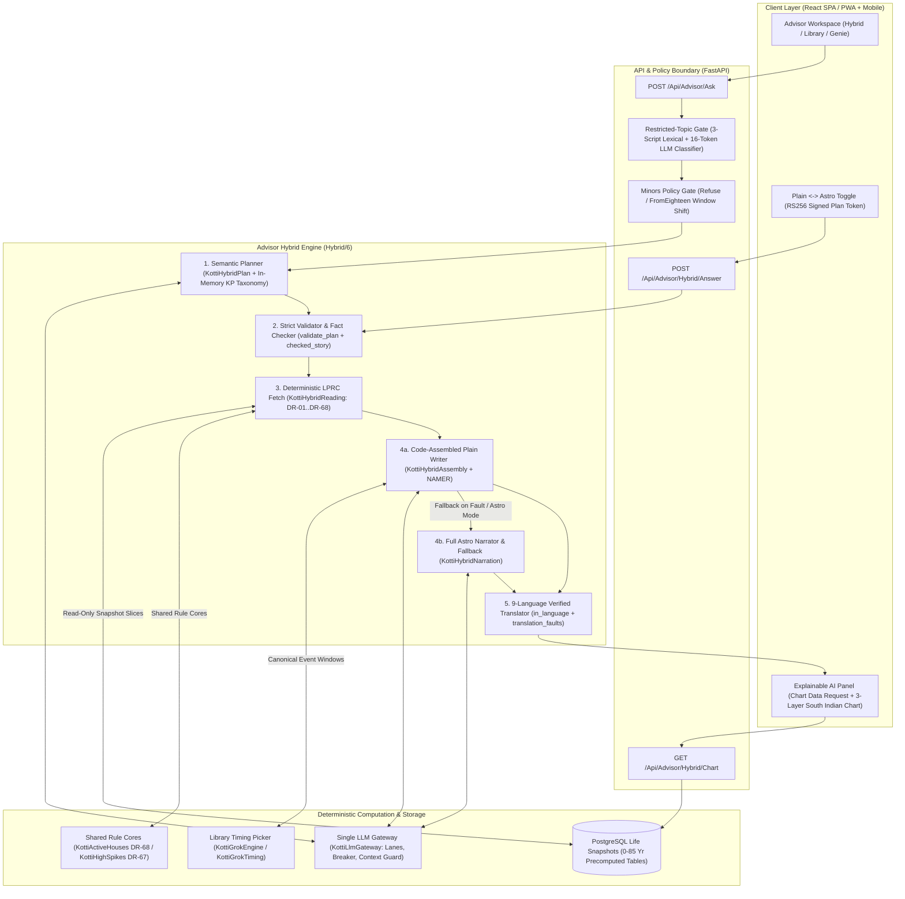
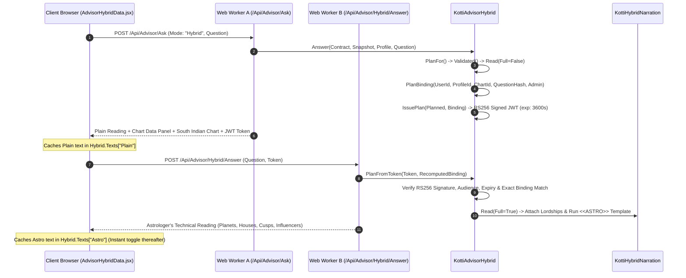
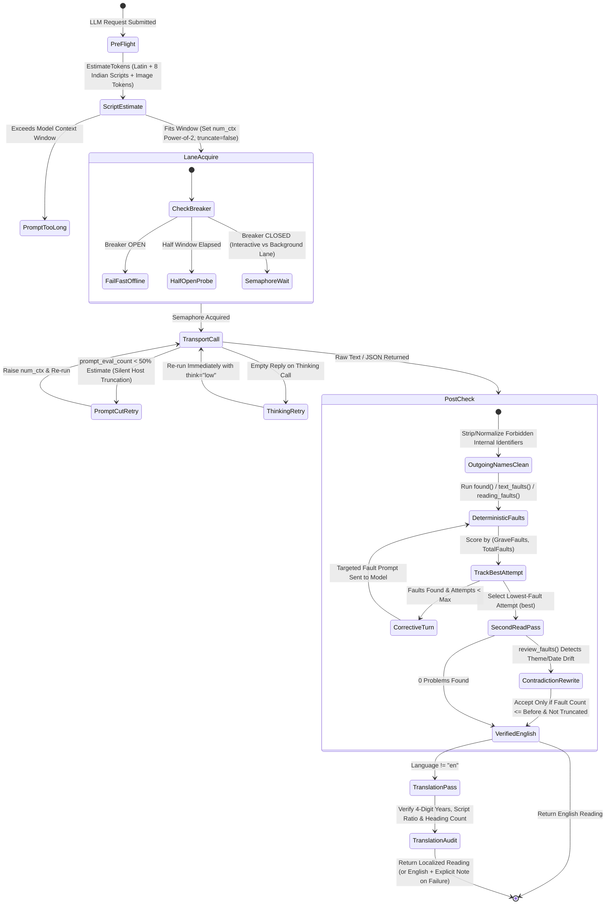
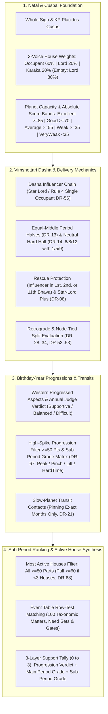

# Kotti Astro — Neuro-Symbolic AI Platform Architecture

**Kotti Astro** is a production-grade **Neuro-Symbolic / Hybrid AI Platform** that combines an **LLM Semantic Planner & Narrator** with a **Deterministic Temporal Computation Engine (`LPRC`)** to deliver explainable, hallucination-free personalized temporal analytics across 9 languages.

> **Architectural Doctrine:** *Language models interpret intent, plan queries, and narrate human context; deterministic code computes every date, weight, score, and temporal boundary.*

---

## 1. Executive Summary & System Scale

Most LLM applications rely on basic RAG (vector similarity + unconstrained text generation), which breaks down when reasoning over dense time-series intervals, multi-factor domain rules, and strict numerical invariants.

**Kotti Astro** solves this through a **Hybrid Neuro-Symbolic Architecture** (`Hybrid/6`):

- **3 Conversational Inference Modes:**
  1. **Advisor Hybrid (`Hybrid/6`):** A 4-stage *Plan → Validate → Fetch → Assemble/Narrate* pipeline combining **KP Stellar** house/period selection, **Parashari Hora** causal story logic, deterministic **LPRC** time-series slices, and **Code-Assembled Plain Prose** with an instant cryptographic toggle (`Astro` mode) for technical astrological auditability.
  2. **Advisor Library (`GROK Engine`):** A 100-row taxonomic event-timing engine (`KottiGrokEngine` / `KottiGrokTiming`) with 11-step house activation chains, 7-point timing tests, and 9-language localized phrase banks (`KottiRoadWords`).
  3. **AI Genie:** Multi-school comparative reasoning across Parashari, KP, Jaimini, Nadi, Tajika, Lal Kitab, Muhurta, Vargas, and Western systems.
- **Single-Chokepoint LLM Gateway (`KottiLlmGateway`):** Enforces two concurrency lanes (`Interactive` and `Background`), script-aware context sizing across 9 languages, `PromptCut` truncation detection, circuit breakers, and bounded self-healing retry loops.
- **68+ Deterministic Domain Rules (`DR-01` – `DR-68`):** Pure-function rule cores (`KottiRuleBook`, `KottiActiveHouses`, `KottiHighSpikes`, `KottiDashaHalves`) operating over immutable precomputed life snapshots (`0–85` years).
- **Explainable AI (XAI) & Stateless Plan Replay:** Every Hybrid answer renders a live **Chart Data Request** audit panel alongside a 3-layer interactive South Indian chart (`Dynamic`, `Progression`, `Slow Transit`) and issues an **RS256-signed JWT execution plan** so users can switch between consumer (`Plain`) and expert (`Astro`) views across stateless web workers with zero drift.

---

## 2. End-to-End Platform Topology

---

## 3. Advisor Hybrid (`Hybrid/6`): 4-Stage Neuro-Symbolic Pipeline

Free-form LLM generation over dense temporal tables frequently hallucinates dates, inverts house lordships, or softens unfavourable grades. In blind A/B evaluations across 50 benchmark questions, **Code-Assembled Plain Answers** (`KottiHybridAssembly`) beat pure LLM narration **26 to 6 (with 4 ties)** by separating *semantic framing* from *factual assembly*.

```mermaid
flowchart LR
  subgraph S1["Stage 1: Semantic Plan"]
    Q["User Question + Profile Context"] --> P1["LLM First Probe (KP Stellar + Parashari Story)"]
    KPL[("In-Memory KP List (KottiHybridMatters)")] --> P1
    P1 --> RAW["Raw JSON Plan (Matters, Houses, Dashas, Window, Story Logic)"]
  end

  subgraph S2["Stage 2: Deterministic Validation"]
    RAW --> V1["Schema & Stray-Token Repair (_parsed)"]
    V1 --> V2["KP Taxonomy Match & Life-Stage Clipping (validate_plan)"]
    V2 --> V3["Natal Fact Verification (checked_story)"]
  end

  subgraph S3["Stage 3: Zero-Math LPRC Fetch"]
    V3 --> F1["Dated Period Stretches & Equal Halves (DR-13)"]
    V3 --> F2["3-Voice Delivery Chains (60% Occupant / 20% Lord / 20% Karaka)"]
    V3 --> F3["Retrograde Splits (DR-28..34), Floors (DR-35..36) & High Spikes (DR-67)"]
    V3 --> F4["Most Active Houses >=80 / >=60 (DR-68)"]
  end

  subgraph S4["Stage 4: Dual-Path Synthesis & Guardrails"]
    F1 & F2 & F3 & F4 --> PATH{"Telling Mode?"}
    PATH -- "Plain (Default)" --> LIB["Library Event Picker (library_times)"]
    LIB --> NAMER["Micro-LLM Trip: Event, Subject & 1 Action Step (NAMER)"]
    NAMER --> CODE["Deterministic Prose Assembler (KottiHybridAssembly)"]
    CODE --> CHK1{"text_faults() Clean?"}
    CHK1 -- "Yes" --> TR["9-Language Verified Translation"]
    CHK1 -- "No (Fallback)" --> FULL["Full LLM Narrator (KottiHybridNarration)"]
    PATH -- "Astro (JWT Replay)" --> FULL
    FULL --> CHK2["Multi-Turn Fault Repair + 2nd-Read Contradiction Pass"]
    CHK2 --> TR
  end
```

---

## 4. Stateless Cryptographic Plan Replay (`Plain` ↔ `Astro` Toggle)

When a client reads a **Plain** answer (written in everyday language with zero planet or house jargon) and clicks the **Astro** button to inspect the underlying astrological mechanics, the platform guarantees **100% plan consistency** across distributed web workers without sticky sessions or database writes:

---

## 5. Single LLM Gateway & Self-Healing Verification State Machine

Every LLM call in the platform passes through `KottiLlmGateway`. No feature module may invoke a model transport directly. Both the Gateway and the Hybrid Narrator enforce strict pre-flight, in-flight, and post-flight invariants:

---

## 6. Deterministic Temporal & House-Flow Engine (`DR-01` – `DR-68`)

Beneath the AI layer sits a deterministic calculation and rule engine that precomputes a native's entire 85-year life snapshot and evaluates 68 codified astrological rules (`DR-01` through `DR-68`):

---

## 7. Repository Contents

### AI Platform Architecture Documentation
| Document | Focus Area |
| :--- | :--- |
| **[ARCHITECTURE-HYBRID-ADVISOR.md](ARCHITECTURE-HYBRID-ADVISOR.md)** | Deep-dive into **Advisor Hybrid (`Hybrid/6`)**: Semantic planning, KP taxonomy matching, deterministic LPRC fetching, code-assembled prose vs. full narration, and stateless JWT plan replay. |
| **[ARCHITECTURE-LLM-GATEWAY-AND-GUARDRAILS.md](ARCHITECTURE-LLM-GATEWAY-AND-GUARDRAILS.md)** | Deep-dive into **`KottiLlmGateway`** and **Multi-Tier Guardrails**: Concurrency lanes, circuit breakers, `PromptCut` protection, regulatory topic gates, and self-healing verification loops. |
| **[ARCHITECTURE-DETERMINISTIC-ENGINE.md](ARCHITECTURE-DETERMINISTIC-ENGINE.md)** | Deep-dive into the **LPRC Snapshot Engine & Shared Rule Cores (`DR-01`–`DR-68`)**: Precomputed 85-year life tables, `KottiActiveHouses` (`DR-68`), `KottiHighSpikes` (`DR-67`), and `GROK` event timing. |
| **[ARCHITECTURE-MULTIMODAL-AND-LOCALIZATION.md](ARCHITECTURE-MULTIMODAL-AND-LOCALIZATION.md)** | Deep-dive into **9-Language Verified Localization, Vision Pipelines (Palm & Face), Explainable AI (XAI) Frontend, and Automated Quality Gates**. |

### Domain Rule Specifications & Scoring Methodology
| Document | Focus Area |
| :--- | :--- |
| **[Planet Strength & Bhava Scoring Methodology.md](Planet%20Strength%20%26%20Bhava%20Scoring%20Methodology.md)** | Mathematical formulation of planet capacity, light basis, performance, resource, and 60/20/20 house scoring. |
| **[Planet Strength, House Analysis & Scoring.md](Planet%20Strength%2C%20House%20Analysis%20%26%20Scoring.md)** | Detailed breakdown of house evaluation, leadership rules, and multi-factor strength bands. |
| **[Planetary Rules, Dasha & House Analysis.md](Planetary%20Rules%2C%20Dasha%20%26%20House%20Analysis.md)** | Core Vimshottari dasha delivery mechanics, two-house lord halves, and Dasha Influencer routing. |
| **[Q & A - Rule 4, Retrograde & Chart Analysis.md](Q%20%26%20A%20-%20Rule%204%2C%20Retrograde%20%26%20Chart%20Analysis.md)** | Edge-case specifications for Rule 4 single-star occupants (`DR-56`), retrograde motion turns (`DR-28`–`DR-34`), and cancellation bands. |
| **[Q&A - Progressions, Lordships and When to Use Bhavas.md](Q%26A%20-%20Progressions%2C%20Lordships%20and%20When%20to%20Use%20Bhavas.md)** | Integration of annual progressions with sign-based vs. cuspal (`bhava`) house placements. |
| **[Bhava & Yoga.txt](Bhava%20%26%20Yoga.txt)** | Classical reference notes on house significations and Pancha Mahapurusha / Balarishta yoga floors. |

---

## Author

**Vasudeva Kotti** — AI Platform Architect  
[LinkedIn](https://www.linkedin.com/in/vasudeva-kotti/) · [GitHub Profile](https://github.com/VasudevaKotti) · vasudevakotti@gmail.com
